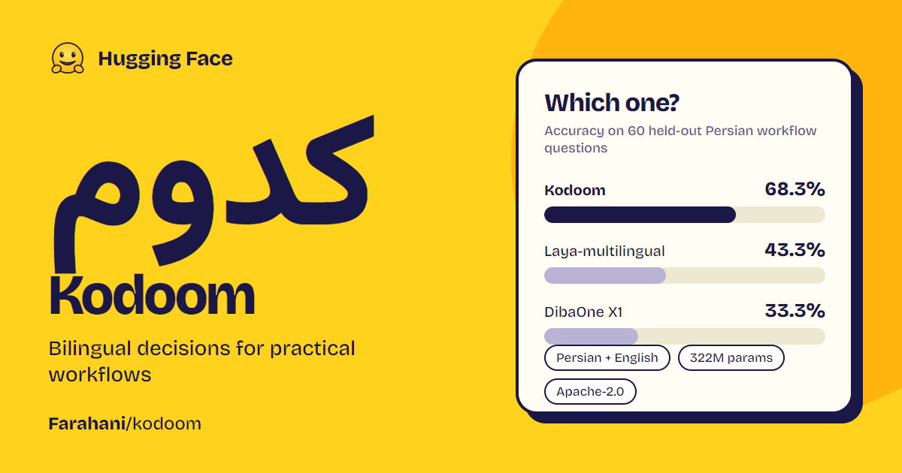

**Kodoom is fine-tuned for decisions in Persian and English: the Persian
evaluation shows gains, and the model author reports measured English gains of
nearly the same magnitude. [See context, question, and answer examples](MODEL_CARD_EXAMPLES.md).**

# Kodoom: bilingual decisions for practical workflows



**Turn Persian or English context into a choice your application can act on.** Kodoom is a
322M-parameter Persian-focused adaptation of Laya-multilingual for developers
building support triage, invoice workflows, agent monitoring, and security
incident tools. Supply the context, a question, and candidate answers; the model
scores the answers and returns probabilities, giving your application a
structured decision interface.

**Why "Kodoom"?** In colloquial Persian, **کدوم** means **"which?" or "which
one?"** It is a natural way to ask a decision question, such as "Which option
should I choose?" The name reflects the model's purpose: choosing among supplied
alternatives using the available context.

**68.3% accuracy on the selected held-out Persian workflow questions**, compared
with **43.3% for Laya-multilingual** and **33.3% for DibaOne X1**: gains of
**25.0 and 35.0 percentage points**, respectively. This evaluation covers 60
questions from 12 complete cases, with higher point accuracy in all four tested
workflows. It is a sample evaluation, not a score on the entire test split.

**English evaluation update:** The model author reports that measurements on
English data show nearly the same improvement as the Persian results. The
English test results and evaluation details will be included soon. The
numerical tables and confidence intervals currently presented in this card
cover **Persian only**; no English scores or intervals are supplied here.

**The English–Persian data used to train Kodoom will be released soon.** The
planned dataset home is [Farahani/kodoom-en-fa](https://huggingface.co/datasets/Farahani/kodoom-en-fa).

## Where Kodoom is most useful

Kodoom is a candidate for Persian applications with an explicit answer space:
choosing a workflow action, flagging a case for review, or assigning one of a
defined set of levels. Its strongest evidence comes from new cases within the
same four workflow families represented during fine-tuning.

| Tested workflow | What the data contains and why it matters | Kodoom | Laya-multilingual | DibaOne X1 |
| --- | --- | ---: | ---: | ---: |
| Invoice processing | Structured invoice-processing scenarios, with questions about the appropriate decision. Relevant to applications that turn invoice context into a workflow outcome. | **73.3%** | 33.3% | 33.3% |
| Security incidents | Incident scenarios requiring decisions from the supplied evidence. Relevant to incident triage and review tools with predefined outcomes. | **80.0%** | 60.0% | 46.7% |
| Agent trace observability | Agent execution traces and monitoring decisions, including whether to continue, observe, request human review, or stop. Relevant to agent oversight and escalation workflows. | **66.7%** | 46.7% | 40.0% |
| Customer service | Customer-service scenarios with associated decision questions. Relevant to support tools that select a next step from a defined action list. | **53.3%** | 33.3% | 13.3% |
| **All four workflows** | **60 questions across 12 held-out cases.** | **68.3%** | **43.3%** | **33.3%** |

Each workflow contributes **3 cases and 15 questions**. Cases come from the
released typed-decisions **test** split; none is part of Kodoom's fine-tuning
partition. These are synthetic English scenarios with machine-translated Persian
natural-language fields, rather than a collection of production Persian tickets,
invoices, or incidents. Identifiers, numbers, machine fields, and protected code
or logs are retained under the dataset's translation policy.

The workflow results support a focused use case: adapting a decision model to
Persian operational scenarios. They do not establish production reliability or
transfer to every new business domain. With only three sampled cases per
workflow, individual workflow percentages are preliminary.

## Different kinds of decisions

The held-out workflow sample includes three original question types. Kodoom has
higher point accuracy than both baselines in each of them:

| Original question type | Decision being tested | Questions | Kodoom | Laya-multilingual | DibaOne X1 |
| --- | --- | ---: | ---: | ---: | ---: |
| Choice | Select one of the supplied actions or answers. | 18 | **66.7%** | 44.4% | 11.1% |
| Yes/no (`noul`) | Decide whether a stated condition holds. | 18 | **88.9%** | 66.7% | 72.2% |
| Score | Select a level from the supplied scale. | 24 | **54.2%** | 25.0% | 20.8% |

**All three models were evaluated through the same choice interface.** Yes/no
questions became two-option choices, and score questions became choices over
their levels, preserving the original targets and option order. This makes the
comparison compatible with DibaOne X1's choice-only interface. These numbers
measure answer selection through that conversion; they do not measure native
yes/no or score heads, continuous scoring, or ordinal error.

### Better agreement with probability targets

The workflow data supplies probability distributions rather than only hard
labels. Kodoom improves agreement with those distributions as well as top-answer
accuracy:

| Metric on the same 60 workflow questions | Kodoom | Laya-multilingual | DibaOne X1 |
| --- | ---: | ---: | ---: |
| Cross-entropy / NLL, lower is better | **1.003** | 1.899 | 1.430 |
| Brier score, lower is better | **0.126** | 0.416 | 0.335 |
| KL divergence from gold, lower is better | **0.243** | 1.138 | 0.670 |
| Expected calibration error, 15 bins, lower is better | **0.118** | 0.245 | 0.227 |

Accuracy counts a prediction as correct when its selected option has the
highest gold probability, including ties. Matching a synthetic target does
not independently establish that the decision is correct in the real world.

The saved paired source-case bootstrap gives a 95% interval of **+5.0 to +46.7
percentage points** for Kodoom's accuracy gain over Laya-multilingual, and
**+23.3 to +48.3 points** over DibaOne X1 on this selected workflow sample.

## Additional Persian text evaluations

Two external Persian task samples also show higher point accuracy than both
baselines. These resources were excluded from this Kodoom fine-tuning run.

| Data and task | What is tested | Questions | Kodoom | Laya-multilingual | DibaOne X1 |
| --- | --- | ---: | ---: | ---: | ---: |
| ParsiNLU paraphrase | Whether two Persian questions express the same meaning. Relevant to evaluating question matching and duplicate detection. | 100 | **58.0%** | 56.0% | 52.0% |
| PersianQA answerability | Whether a supplied Persian passage contains an answer to a question, expressed as a two-option decision. Relevant to evaluating an answerability check before a QA step. | 100 | **73.0%** | 72.0% | 70.0% |

These are **small observed gains**, not established generalization improvements:
the paired 95% accuracy-difference intervals include zero against both baselines.
PersianQA here measures **answerability**, not answer extraction or generated
answer quality. Exclusion from Kodoom fine-tuning does not establish absence
from upstream models' pretraining or training data.

### Separate diagnostic: translated Helmo scenarios

A broader diagnostic uses **621 translated questions across 207 Helmo topics**,
sampling three items per topic from the source's **training split**. The topics
span technical systems, business subjects, and general knowledge; some states
contain protected code or logs. Choice, yes/no, and score questions use the same
shared choice conversion described above.

| Source-train diagnostic | Kodoom | Laya-multilingual | DibaOne X1 |
| --- | ---: | ---: | ---: |
| Translated Helmo, 621 questions | **42.5%** | 39.3% | 30.4% |

This is a **training-source diagnostic, not a held-out benchmark**. The recorded
Kodoom recipe used typed-decisions only and did not select Helmo augmentation;
the Helmo source split nevertheless remains `train`. The aggregate is not
evidence of improvement in each of its 207 topics, and is not pooled with the
held-out scores.

This card highlights task groups with higher observed accuracy than both named
baselines. It is a selected capability summary, not a complete evaluation table
or a claim of superiority across Persian language tasks.

## Model and training data

Kodoom continues full encoder and decision-head fine-tuning from
[Laya-multilingual](https://huggingface.co/convaiinnovations/laya-multilingual).
The upstream architecture is a bidirectional mmBERT-base encoder with a decision
head, approximately **322 million parameters** in total. It scores supplied
options without autoregressive answer generation. Candidate options are supplied
per request rather than fixed to one task's label vocabulary.

The recorded run, `laya-full-v1`, uses the accepted English–Persian typed-decisions
release **1.0.1**, schema **1.0.0**. Its four workflow families are agent traces,
customer service, invoice processing, and security incidents. Each case has five
decision questions, with aligned English/Persian context, questions, option
descriptions, and frozen probability targets.

| Partition | Cases | Paired English–Persian questions | Language-specific examples |
| --- | ---: | ---: | ---: |
| Fine-tuning | 960 | 4,800 | 9,600 |
| Development | 120 | 600 | 1,200 |
| Reserved calibration | 120 | 600 | 1,200 |
| Released test | 400 | 2,000 | 4,000 |

Cases and their language variants remain together; development and calibration
are derived from the original training split. The reported workflow evaluation
samples **12 of the 400 test cases**, using Persian questions only.

The training handoff records **600 optimizer updates**, two epochs, effective
batch size 32, and **50% Persian / 50% English replay** on Kaggle T4 x2. It uses
soft-target cross-entropy and selects the best checkpoint using development
criteria. The reported best Persian development loss is **0.953416**. English
replay is part of the bilingual recipe. The author-reported English gains
described above await their accompanying test results and evaluation details;
the supplied Persian evaluation does not establish performance in other languages.

The broader bilingual dataset also contains a separate 2,000-question Helmo
component. Those rows, the full released test split, and untranslated original
Helmo items must not be counted as Kodoom training examples.

The Persian fields are machine translations. The supplied dataset card records
a 100-case AI audit, not human review; it provides no measured human translation
error rate. The training data and its provenance will be released soon at
[Farahani/kodoom-en-fa](https://huggingface.co/datasets/Farahani/kodoom-en-fa).

## Using the evaluated checkpoint

The evaluated weights are in
[Farahani/kodoom](https://huggingface.co/Farahani/kodoom), at revision
`f315b5da129e2b1df55d971ddf2053c3cbfe5282`, under **`laya-full-v1/best/`**.
Use the best inference checkpoint rather than the `latest/` training-resume
state. Repository access depends on its publication status.

The decision input consists of:

- **State:** the Persian text or structured context containing the evidence.
- **Question:** the decision your application needs to make.
- **Options:** stable IDs with descriptions of the candidate answers.
- **Output:** a probability for each candidate option, from which the application
  can select an answer or apply a review threshold.

For the measured comparison, all models receive the same Persian normalization
through `kodoom.normalize.normalize`. Laya and Kodoom use a **1,024-token total
input budget** and **256-token question/options budget**. Keep decision evidence
within the available context and account for truncation. These results do not
validate longer-context use.

Kodoom and Laya use **temperature 1**; X1 uses its shipped calibration. No
temperature is fitted on these test samples. Improved calibration metrics here
do not imply that probabilities or review thresholds are calibrated for a new
deployment. Validate those on separate examples from the intended application.

## Evaluation scope and reproducibility

The [evaluation files and protocol](https://huggingface.co/Farahani/kodoom/tree/main/eval/persian-shared-choice-v2)
include the complete aggregate report, a CSV summary, sanitized provenance,
and checksums. They retain all evaluated tasks, including outcomes outside
this card's selected capability summary. They contain no benchmark passages,
per-item records, or sample ID lists.

The completed run uses protocol **`shared-choice-persian-v2`**, seed **17**, and
identical selected questions and option order for all three models. It reports
**100% prediction coverage and zero prediction errors** for every model.
Inference ran on a Tesla T4 with microbatch 4. No latency or hardware-efficiency
advantage is claimed by this card.

| Component | Frozen identity |
| --- | --- |
| Kodoom | `Farahani/kodoom` · `f315b5da129e2b1df55d971ddf2053c3cbfe5282` · `laya-full-v1/best/` |
| Original Laya-multilingual | `convaiinnovations/laya-multilingual` · `1720e3e3357cfe1e281542e223f8273b0890ca34` |
| DibaOne X1 | `Dibachain/DibaOne-X1` · `a7d696cb743ba41a941934196fcc447d7c39b9b6` · `best`, PyTorch backend |
| Bilingual dataset | `Farahani/kodoom-en-fa` · `1b98bbba48043c62c6ae2c821a55b6f8a5e7a927` · release 1.0.1 |
| ParsiNLU | `persiannlp/parsinlu` · `a3b08d0b93ca84e0017e2f490a2aa3ab36c79885` · official test files |
| PersianQA | `sajjjadayobi/PersianQA` · `ba4806eb7894b1e78e214e16e7e717840c129450` · test split |
| Evaluation code | `30ed4c86d42f2050dc027cbe608d0dc45afe9721` |
| Laya/Kodoom inference implementation | `ffc142012af63d015fa19f05f29f9c5ff329a2cc` |

The saved evidence consists of `manifest.json`, `samples.json`, `report.json`,
`summary.csv`, `comparison.csv`, and per-model prediction files. The manifest
records selected data identities, inference settings, dependencies, and SHA-256
hashes. The 25 inventoried output files were checked against those hashes when
preparing this card.

Evidence fingerprints (SHA-256):

```text
report.json
28c3d87f381a65c89a22783fad8993df39acb99cec94507752c57ed3bedad050

samples.json
57468f8012f668e2d3c61517fbe6e3a721a1de9d45faa3669d238431d21745fc

accepted dataset release manifest
89859f966e8af06abe965dbe0cb2a966edd6b9b4488a10ada5d6b0e3831f8419
```

## Attribution and licensing

Kodoom builds on [Laya-multilingual](https://huggingface.co/convaiinnovations/laya-multilingual),
whose model card declares Apache-2.0. Its fine-tuning source,
[LocalLLaMA/typed-decisions](https://huggingface.co/datasets/LocalLLaMA/typed-decisions),
declares Apache-2.0. The supplied Persian translation contributions have an
owner-approved Apache-2.0 grant for rights held by the grantor. The separate
[Helmo source](https://huggingface.co/datasets/helmo/synthetic-typed-decisions)
retains MIT terms. Dataset component licenses and notices remain distinct.

The existing [Kodoom model repository](https://huggingface.co/Farahani/kodoom)
declares **Apache-2.0** for its model release; this card preserves that declaration.
The kodoom code repository's **0BSD license** is separate from model-weight
and dataset licensing.

Evaluation credits: [ParsiNLU](https://github.com/persiannlp/parsinlu) and
[PersianQA](https://github.com/sajjjadayobi/PersianQA). Their evaluation-only use
in this run does not make them part of the fine-tuning corpus.
